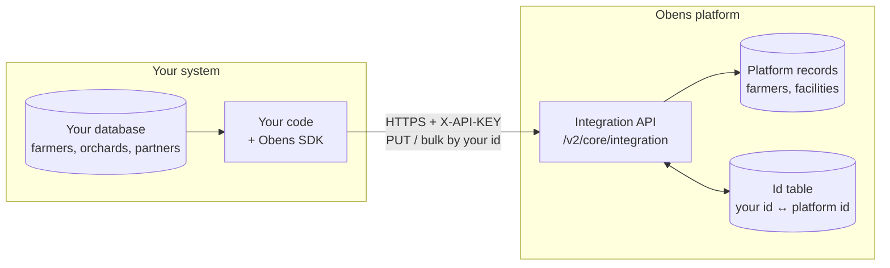
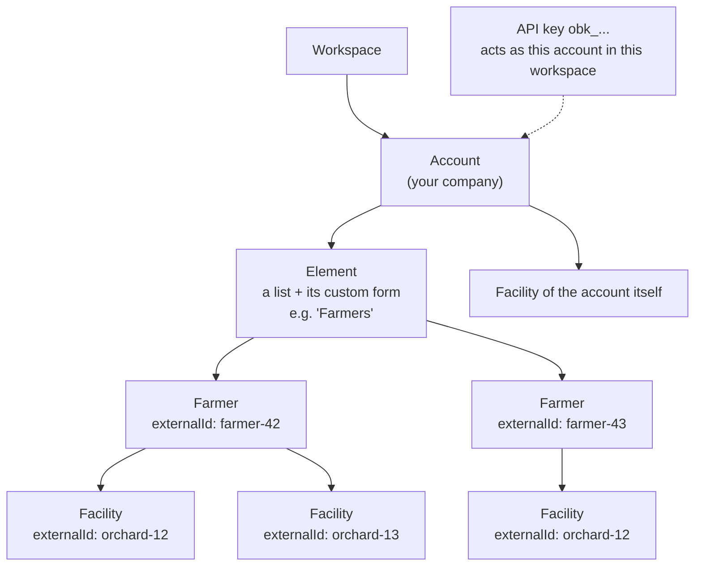
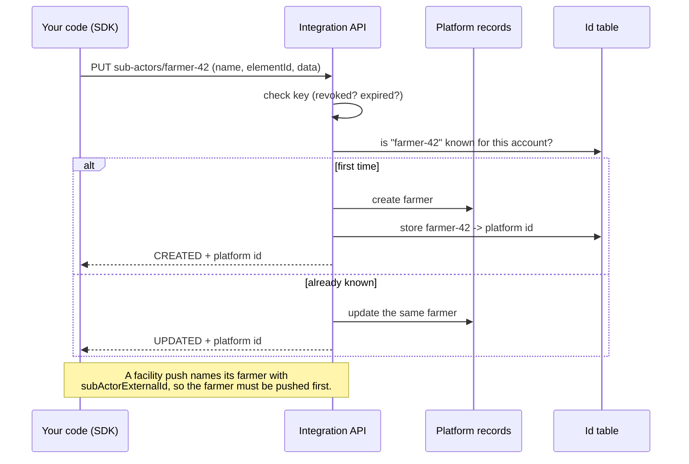
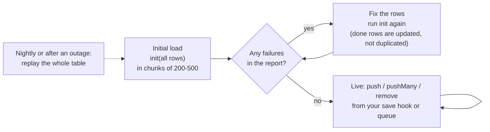
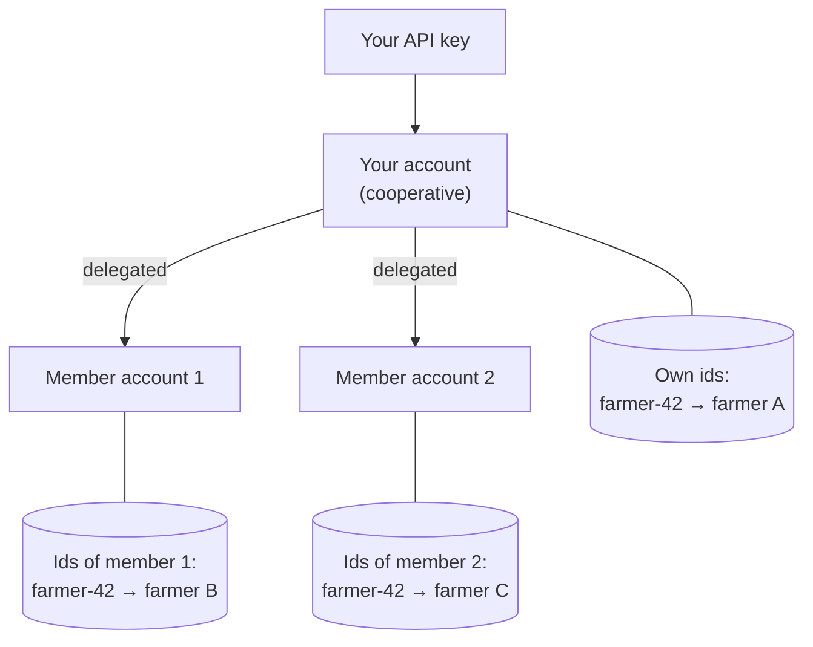
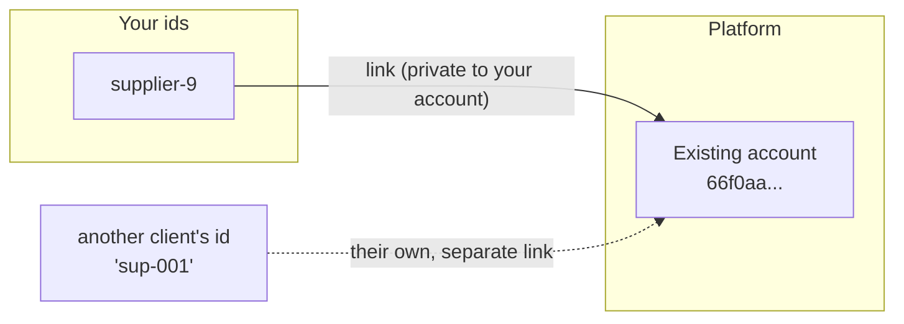

# obens-sdk (Java)

Source: https://github.com/Obens-Ltd/obens-sdk-java

Push your farmers, facilities and partners to the Obens platform under **your own ids**, and translate ids both ways.
Java 17+, one dependency (Jackson). Uses the JDK `HttpClient`.

```xml
<dependency>
  <groupId>so.obens</groupId>
  <artifactId>obens-sdk</artifactId>
  <version>0.1.0</version>
</dependency>
```

## How it fits together

Six small pictures of what happens behind the SDK (Mermaid diagrams, GitHub draws them).

### The big picture

Your system keeps its own ids. The SDK sends records with those ids to the platform; the platform stores its own id
next to yours and can translate either way.



### What an API key is allowed to touch

A key is bound to **one account in one workspace**. It can only see that account's records (plus accounts that
delegated to it, see below). Farmers live in an **element** (a list with its own custom form); facilities (orchards,
plots...) belong to a farmer.



Notice `orchard-12` twice: a facility id is unique **per owner**, so the same id under two farmers is two different
facilities. Farmers have their own id space, facilities have theirs.

### One push, step by step

The first push of an id creates the record, every later push updates it. That is why retries and full replays never
create duplicates.



### Load once, then push changes



### Acting for other accounts (delegation)

If other accounts have delegated to the key's account (a cooperative and its members, for example), the same key can
act on them. Each account has its **own** id space, so `farmer-42` of the cooperative and `farmer-42` of a member are
different farmers.



A revoked delegation answers `403` on the next call.

### Matching accounts that already exist

Accounts are shared between clients, so an account cannot carry your id. You **link** your id to it; the link is
private to your account.



## 1. Get an API key

In the platform: **Settings → API keys → Create key**. Pick the account and workspace it acts as. The secret
(`obk_...`) is shown **once**, store it like a password. Keys can be revoked or set to expire.

## 2. Connect

```java
var client = ObensClient.builder("https://api.obens.so/v2/core", System.getenv("OBENS_API_KEY")).build();

System.out.println(client.whoami());    // Whoami[keyId, keyName, accountId, workspaceId]
System.out.println(client.elements());  // the lists farmers can be created in -> you need one id
```

Transient failures (timeouts, 429, 5xx) are retried with backoff (`.maxRetries(..)`, `.retryDelay(..)`,
`.timeout(..)` on the builder). Every call is an upsert, so a retry or a replay never duplicates a record.

## 3. Write a mapper

A mapper turns **your** record into what the platform expects. A dotted key builds a nested object, a `null` value is
left out so an update never blanks a field.

```java
record Farmer(String id, String firstName, String lastName, String village, String sex) {}

Mapper<Farmer> mapFarmer = Mapper.<Farmer>builder()
    .field("externalId", Farmer::id)                       // YOUR id: required, the key of the mapping
    .field("name", f -> f.firstName() + " " + f.lastName())
    .field("address", Farmer::village)
    .field("gender", f -> "F".equals(f.sex()) ? "FEMALE" : "MALE")
    .constant("elementId", FARMERS_ELEMENT)
    .constant("type", "FARMER")
    .build();
```

Any `Function<R, Map<String, Object>>` works too.

## 4. Initial load

```java
var farmers = client.syncer(Syncer.Kind.SUB_ACTORS, mapFarmer, 200, r -> System.out.println(r.total()));

SyncReport report = farmers.init(allFarmers);   // an Iterable, or an Iterator over a cursor to stream a big table
System.out.println(report.created() + " created, " + report.updated() + " updated, " + report.failed() + " failed");
report.failures().forEach(f -> System.out.println(f.externalId() + ": " + f.error()));
```

One bad row never stops the load; it is listed in `failures()`. Run `init` again after fixing them: rows already
pushed are updated, not duplicated.

## 5. Push changes

```java
farmers.push(farmer);               // one change: call it from your save hook / queue consumer
farmers.pushMany(changedFarmers);   // a batch of changes
farmers.remove(farmer);             // delete (soft: the platform keeps the record)
```

Facilities work the same way:

```java
var facilities = client.syncer(Syncer.Kind.FACILITIES, Mapper.<Site>builder()
    .field("externalId", Site::id)
    .field("info.name", Site::title)
    .field("coordinates", s -> Map.of("type__", "Point", "latitude", s.lat(), "longitude", s.lng()))
    .build());
```

### Facilities of a farmer

A farmer can own many facilities (orchards, plots...). Give the farmer's external id in `subActorExternalId` and the
facility belongs to that farmer. The farmer must have been pushed first. A facility's id is unique **per owner**, so
read it back with the same farmer:

```java
Mapper.<Site>builder().field("externalId", Site::id).field("subActorExternalId", Site::farmerId).field("info.name", Site::title)
client.facilities().get("orchard-12", "farmer-42");
```

## 6. Match your ids to platform ids

```java
var ids = client.idMap(MappingType.SUB_ACTOR).load();    // SUB_ACTOR | FACILITY | ACCOUNT
ids.internal("farmer-42");                               // Optional<String>: the platform id
ids.external("66f0c0...");                               // Optional<String>: your id

// link one of your partners to an account that already exists on the platform
client.accounts().link("supplier-9", "66f0aa...");
```

### Custom fields

```java
var fields = client.subActorSchema(elementId); // [{name, staticId, type, writable, choices}]
```

Put plain values in `data`, keyed by field `name` or `staticId`:

```java
Mapper.<Farmer>builder()
    .field("externalId", Farmer::id)
    .field("name", Farmer::fullName)
    .constant("elementId", ELEMENT_ID)
    .field("data", f -> Map.of("Crop", f.crop(), "Area (ha)", f.area()))
    .build();
```

Choices accept an option's id, label or value; quantities are `Map.of("value", 1, "unit", "kg")`; dates are
`yyyy-MM-dd`. File, image, table and formula fields can't be written. A bad key or value fails that record with a
message listing every problem; nothing is written for it.

## Delegated accounts

If other accounts have delegated to the key's account, the same key can act on them: create their farmers and
facilities, link their partners and read their id tables.

```java
List<AccountRef> accounts = client.accounts().accessible();      // the key's own account first
var coop = client.forAccount(accounts.get(1).id());              // every call on `coop` acts as that account

coop.syncer(Syncer.Kind.SUB_ACTORS, mapFarmer).init(coopFarmers);
```

Each account has its **own** id space: `farmer-42` of one account and `farmer-42` of another are different farmers.
A revoked delegation stops working on the next call (`403`).

## Errors

A non-2xx answer throws `ObensApiException` (`status()`, `body()`); `401` = missing, wrong, revoked or expired key.
Network failures throw `ObensException`.

Full endpoint reference: `traceability-core/api-docs/integration/readme.md`.

## License

MIT, see [LICENSE](LICENSE).
